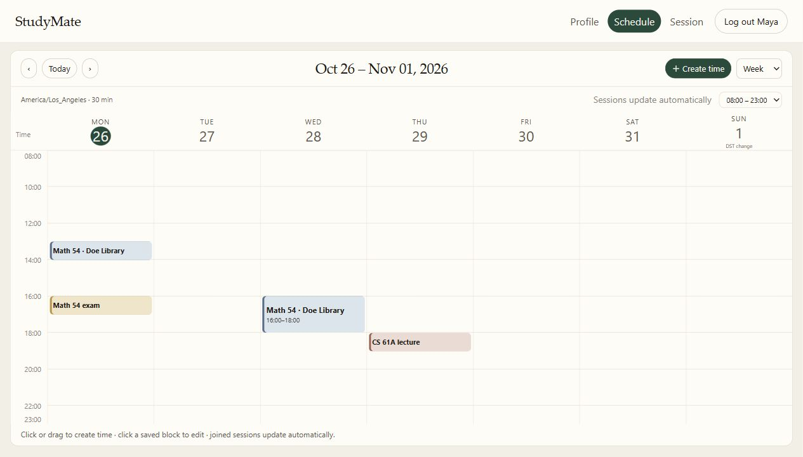

# StudyMate

[](https://github.com/Shuluun/StudyMate/actions/workflows/tests.yml)

**[Try the live demo](https://studymate-shuluun.onrender.com)** — no account or API key needed.
Free hosting may take about a minute to wake up. Each visitor gets temporary fictional data.

**A study-group planner that checks availability before suggesting a session.**

StudyMate brings student profiles, an editable timetable, room discovery, and group
membership into one small FastAPI application. A session should fit the course,
the people, and their actual free time—not just sound plausible in a chat reply.

This is a **team-built hackathon prototype** with a reproducible local demo. It is
useful for studying constraint-aware scheduling and agent-assisted interfaces.
It is not a deployed campus service or a verified student directory.



[中文运行指南](docs/QUICKSTART_ZH.md) · [Architecture](docs/architecture.md) ·
[Demo walkthrough](docs/demo.md) · [Verification](docs/verification.md) ·
[Contributors](CONTRIBUTORS.md) · [Limitations](docs/status.md)

For the browser-only, temporary guest experience, see [Public demo deployment](docs/public-demo.md).
The public host runs the same team UI in separate visitor sandboxes; the persistent
local demo below remains available for development.

## What you can do

- **Build your profile.** Add courses, study preferences, group size, and a travel
  radius. Accounts have separate profiles; incomplete profiles are excluded from matching.
- **Manage your time.** Edit unavailable periods and exams in a week/day timetable.
  Concrete intervals use UTC internally and IANA time zones at the boundary.
- **Find or open a room.** Describe a course and time, inspect compatible rooms,
  join one, or host your own. Hosts can change its time, venue, and capacity.
- **Keep sessions and schedules together.** Joined rooms become read-only schedule
  blocks. Changing a room time updates its members; leaving releases the interval.
  A visible timetable refreshes about every five seconds.
- **Keep your work.** Accounts, profiles, courses, rooms, and schedules persist in
  local SQLite. A PostgreSQL/Supabase backend is also implemented; local verification
  and cloud verification are reported separately.

The normal application has **no Google Calendar connection or calendar writes**.
Some isolated Google adapter tests remain from an earlier prototype.

## Run the complete offline demo

Python **3.11+** is required; recorded local verification uses Python 3.13.5.
No Google account, API key, Supabase project, or model token is needed.

```bash
python -m venv .venv
# Windows
.venv\Scripts\python -m pip install -r requirements-lock.txt
.venv\Scripts\python -m app.demo
# macOS / Linux: use .venv/bin/python for the two commands above
```

Open **http://127.0.0.1:8020**. On Windows, `Setup-StudyMate.cmd` and then
`Start-StudyMate.cmd` provide the same workflow without activating a virtual environment.

Sign in with the fictional demonstration account:

```text
Email:    maya@example.edu
Password: studymate
```

Or register a separate **synthetic** account to test profile and data isolation.
Please do not enter real private information into this prototype.
For a new offline profile, use `UC Berkeley` as the public sample address,
`Physics` as a major and `Math 54` as a course; arbitrary addresses are not geocoded offline.

`app.demo` always binds to loopback, selects local databases under `data/demo/`,
and disables map/model lookups even if a developer has configured credentials.
It keeps existing local edits and never resets the database on startup. To use a
separate disposable demo, pass `--data-dir data/another-demo --port 8032`.

The sample conversations and room board use the fixed week **26–31 October 2026**.
Use the documented examples for a reproducible demo. General relative-date
interpretation is a known limitation, not an implemented calendar assistant feature.

## Why the engineering matters

**Hard rules precede model judgments.** Exams, busy intervals, room capacity and
participant conflicts are checked by server code. An optional model can interpret
requests or rank eligible rooms; it cannot grant availability or write to calendars.

**Private and shared representations are different.** The calendar owner can see
their own event labels. Matching consumes typed interval/priority information, not
private event titles or account credentials. Eligibility is resolved on the server.

**Unknown is not free.** The scheduling core retains a previous snapshot when a
provider read fails and marks incomplete, stale or uncovered data as unknown.
The ordinary timetable uses local/fake calendar data, separated from a verified
external calendar integration.

**A room has one source of truth.** The Calendar adapter reads existing Session
membership rather than inventing a second set of bookings. Availability changes
when members join, leave or reschedule.

## Test it

```bash
python -m pytest -q
python tools/smoke.py
python -m pip check
```

Use your virtual environment's Python. Tests disable external providers and use
temporary data. The HTTP smoke test launches the real app, exercises two accounts,
then restarts its server and verifies persistence and session synchronization.
See [the verification record](docs/verification.md) for exact results and limits.

## Runtime options

| Mode | Command | External services |
|---|---|---|
| Offline local demo | `python -m app.demo` | Disabled; synthetic profiles and fixture venues |
| Configured development | `python -m uvicorn app.main:app --host 127.0.0.1 --port 8020` | Optional map/Omnara calls; SQLite or configured PostgreSQL |
| Public production | Not provided as a turnkey deployment | Requires the gates in [status](docs/status.md) and [configuration](docs/configuration.md) |

PostgreSQL credentials belong in private server configuration, never in the
browser, screenshots, or Git. A Supabase database does not host this FastAPI website.
The app's optional Omnara integration currently uses a **stand-in matching prompt**;
do not describe it as the completed four-tool agent from the historical PRD.

## Repository map

```text
app/
  main.py, demo.py       application composition and isolated local launcher
  accounts.py, db.py    account persistence and SQLite/PostgreSQL database access
  profile_core.py       per-account profiles and candidate eligibility
  matching_core.py      deterministic matching and place constraints
  room_matching.py      room filtering and optional model-assisted ranking
  routers/session.py    room creation, joining, leaving and host controls
  scheduling/           interval engine, persistence, owner APIs and Session adapter
  templates/, static/   server-rendered interface and editable timetable
tests/                  isolated calendar, profile, matching, room and persistence tests
tools/                  real-process smoke test and clean source export
docs/                   architecture, demo, verification and current limitations
```

## Team and reuse

This repository preserves the upstream team's implementation and MIT license.
The Calendar workstream and integration were contributed by **Shulun**. Profile,
Session, Matching and Agent work belong to the corresponding team contributors;
see [CONTRIBUTORS.md](CONTRIBUTORS.md) and Git history. Present it as a team work,
with individual contributions identified explicitly.

The original [hackathon PRD](docs/archive/PRD-2026-10-24.md) is retained as historical
design context. Its proposed emails, calendar exports, production policies and
performance targets are not a list of currently verified capabilities.
