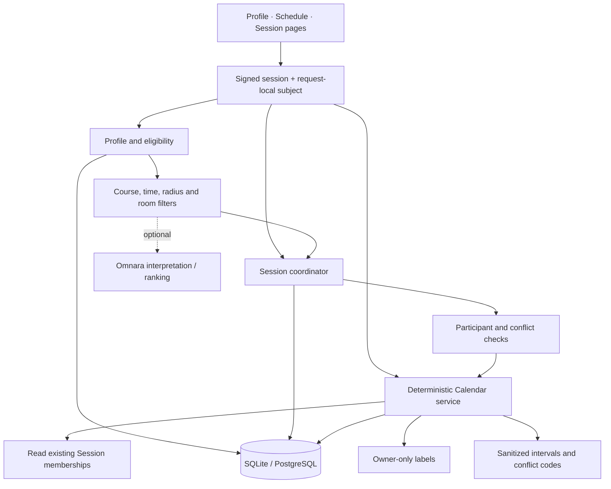

# Architecture and boundaries

The signed-in account travels through request-local context. Profile access,
Calendar ownership and room membership use its ID. `app/db.py` persists accounts,
per-account profiles, courses and rooms; Calendar retains its scheduling repository.
Local storage is SQLite. PostgreSQL uses psycopg and portable upserts.

`app/scheduling/core/` uses typed UTC half-open intervals `[start,end)`. Recurring
wall times retain their IANA zone and handle DST folds/gaps explicitly. Owner APIs
derive the actor server-side; candidate reads require a trusted eligible context.

## Current availability policy

The **team app** defaults to available unless blocked. Manual unavailable periods,
exams, stored busy intervals and confirmed Session reservations subtract from the
horizon. The earlier standalone Calendar required declared weekly study hours.
Legacy weekly records remain, but no longer restrict the team's base calculation.
These are different policies; standalone acceptance results do not prove team policy.

Exam priority is metadata, not permission to ignore conflicts. A conflict preview
does not approve invitations, overrides, bookings or exports.

Room discovery currently admits an existing room that is inside the requested
window **or overlaps it by at least one hour**. The card shows the actual room
time; joining reserves that whole interval, rather than clipping it to the search.
This differs from a strict fully-contained proposal policy and needs an explicit
product decision before treating search results as exact-window appointments.

## One Session source

`TeamSessionGateway` projects current memberships into Calendar reservations; it
does not create a second booking database. Room mutations recheck participant
conflicts. Exclusions cover only the room being changed and actor seats that the
existing switching operation actually releases. Other hard blocks stay enforced.

The visible timetable checks its week API about every five seconds, pausing during
edits/selections and in hidden tabs. This is polling, not WebSocket delivery.

## Optional providers and limits

Offline mode uses fictional users and fixture venues. Normal development may opt
into map/Omnara clients. Model output is validated and hard filters remain in server
code. The current matching prompt is a stand-in. No normal-app email sender or
Google Calendar route is enabled; retained adapter tests are historical isolation tests.

Room JSON persistence still needs a multi-worker transactional reservation design.
Production schema changes should use reviewed migrations with controlled privileges,
rather than relying on application access to create tables and change RLS.
