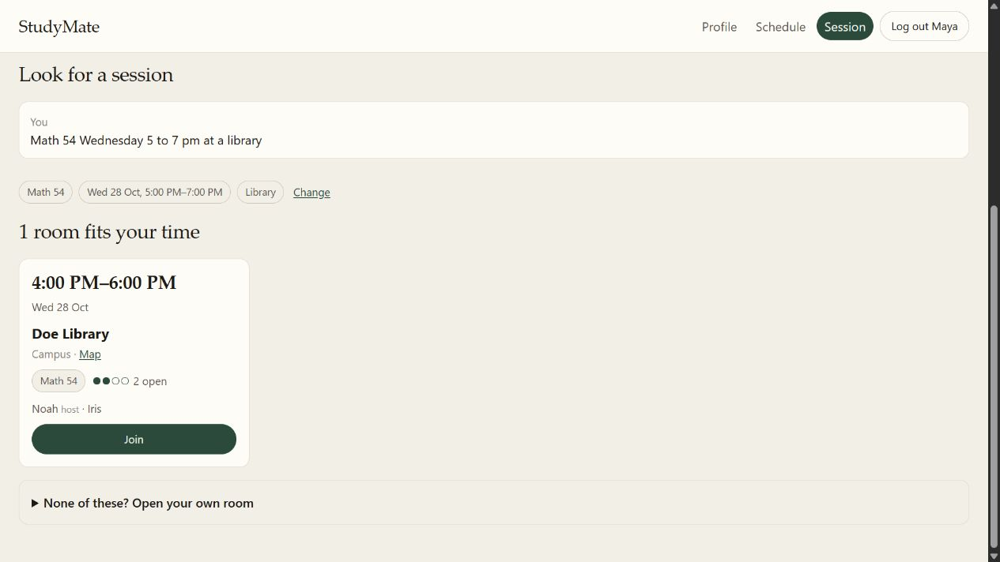

# A five-minute demonstration

Start `python -m app.demo`. Use the documented week and synthetic data.
For untouched seed data, choose a new demo directory; do not delete an existing DB.

1. **Profile.** Sign in as `maya@example.edu` / `studymate`. Inspect the example
   courses/preferences. Separate accounts have independent profiles.
2. **Constraints.** In Schedule, select 26 October 2026. Create an unavailable
   period or exam, edit it, and show that it survives reload.
3. **Request.** In Session enter `Math 54 Monday 1 to 2 pm at a library`.
   Inspect rooms or open one. Offline selection is manual, not a model result.
4. **One source.** Open Schedule in a second tab. A joined/hosted room appears
   as a read-only block. Its source link returns to Session management.
5. **Release.** Change its time or leave. Schedule updates in about five seconds.
6. **Persistence.** Restart using the same directory, sign in again, and inspect
   saved profiles, edits and rooms. The smoke test automates a two-account version.

The parser's relative dates are fixed for this prototype. A venue card does not
book the venue, joining does not send email, and a timetable block does not write
to Google. Discuss deterministic hard rules, suggestion/authority separation,
privacy-separated representations and the Session adapter as the core engineering.

Screenshots use fictional Maya, an added synthetic Math 54 exam, a hosted Monday
room and a joined Wednesday room. They show actual UI interactions, not a mockup
or the untouched seed. A Wednesday 5–7 PM search may show a 4–6 PM room because
the current discovery policy permits one-hour overlap; inspect the actual card time.
